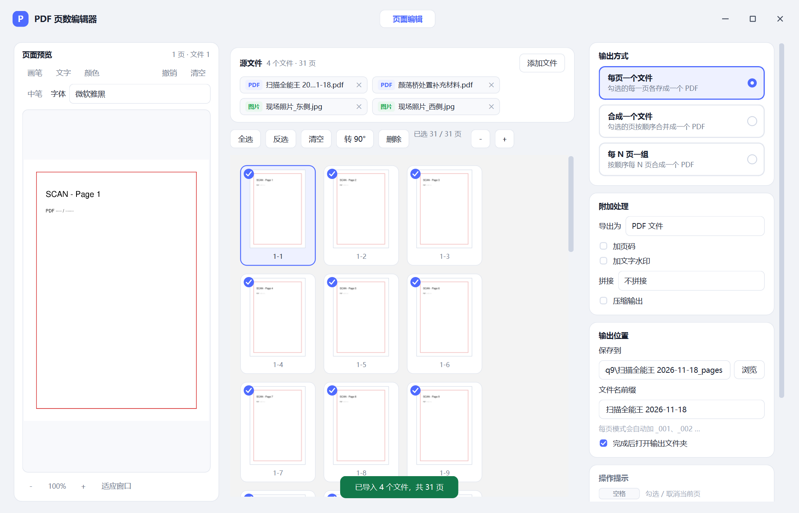
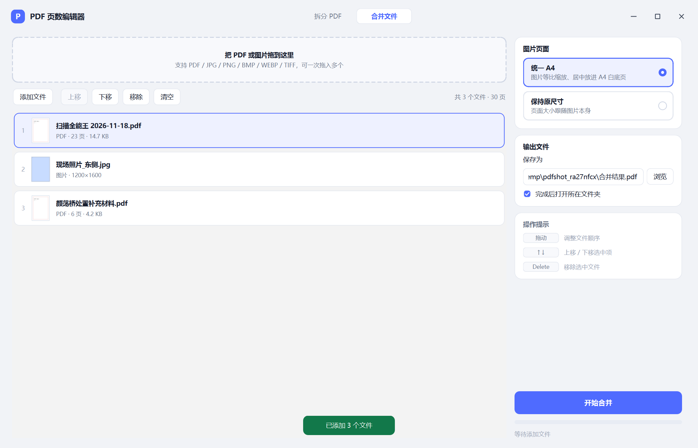
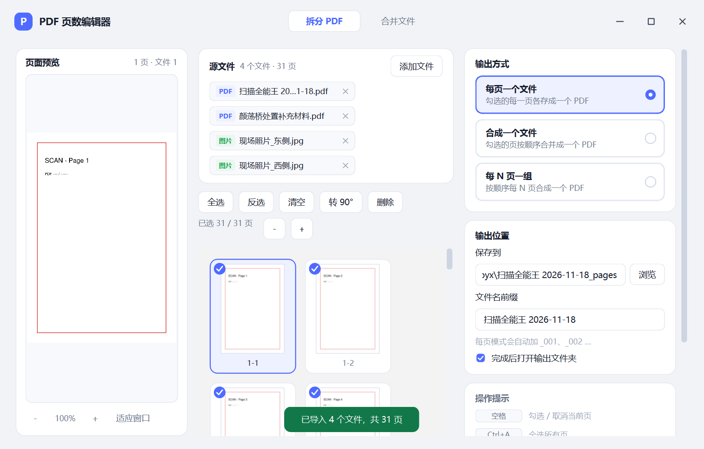

# PDF 页数编辑器

> 一个现代化界面的桌面小工具：把 PDF 拆开、挑页重组、和图片一起合并。




---

## 它解决什么问题

手上的 PDF 常常是这样：一份扫描件几十页，只要其中三页；或者一堆 PDF 加现场照片，要按顺序并成一个文件。
一般做法是打开在线网站、上传、等待、下载——文件还得离开自己的电脑。

这个工具把这些事放在本地做完，拖进来、点两下就出结果。

## 功能

### 拆分 PDF

- **多个来源一起编辑**：可以同时导入多个 PDF 和图片，它们会按导入顺序拼成一个"页面池"，跨文件挑页也能一起导出。文件标签最多占两行，导入再多也只是在框内滚动，不会把缩略图挤走。
- **三种导出方式**
  | 方式 | 说明 | 例（选了 3 页） |
  | --- | --- | --- |
  | 每页一个文件 | 勾选的每一页各存成一个 PDF | `名称_001.pdf` `名称_002.pdf` `名称_003.pdf` |
  | 合成一个文件 | 勾选的页按顺序并成一个 PDF | `名称.pdf`（3 页） |
  | 每 N 页一组 | 按顺序每 N 页合成一个，不足 N 页的单独成组 | `名称_01.pdf` `名称_02.pdf` |
- **页面操作**：勾选 / 取消、转 90°、删除、拖动重排，支持全选、反选、清空。
- **左侧大图预览**：点哪页看哪页，支持滚轮缩放、拖动平移、适应窗口。
- **缩略图尺寸可调**：`－ / ＋` 两档缩放，页数多的时候更省地方。

### 合并文件

- 一次拖入多个 PDF 与图片，拖动排序、上移下移、移除、清空。
- 图片两种落页方式：
  - **统一 A4**：等比缩放后居中放进 A4 白底，适合与文档混排（可选 36–1200 DPI）。
  - **保持原尺寸**：页面大小跟随图片本身。
- 输出路径可改，完成后可自动打开所在文件夹。

### 界面

- 无边框自绘标题栏，四边可拖拽缩放。
- 深色文字 + 浅色卡片，控件按窗口宽度自动折行；窗口缩到 1080×690 也不会有文字被压住。
- 长任务（拆分 / 合并）在后台线程执行，进度条 + 状态文字 + 完成提示，界面不卡。
- 拖放、按钮点击都有即时反馈；错误用红色提示条说明原因。

## 截图

| 拆分 PDF | 合并文件 |
| --- | --- |
|  |  |

窗口缩到最小（1080×690）时，工具行自动折行、右侧栏出现滚动条，文字不会被压住：



## 快速开始

### 方式一：直接用打包好的 exe

1. 下载 `PDF页数编辑器` 整个文件夹（exe 与 `_internal` 必须放在一起）。
2. 双击 `PDF页数编辑器.exe`。

> 单文件 exe 在某些 Windows 环境下会报 `Could not create temporary directory!`（临时目录解压失败），
> 因此发布包统一使用 **onedir** 形式，启动也更快。

### 方式二：从源码运行

```bash
git clone <仓库地址>
cd pdf-page-editor
pip install -r requirements.txt
python run.py
```

也可以用模块方式启动：

```bash
set PYTHONPATH=src
python -m pdf_editor
```

## 使用说明

### 拆分

1. 「添加文件」或直接把 PDF / 图片拖进窗口，可多选。
2. 在缩略图区勾选需要的页（默认全选），需要时转 90°、删除、拖动排序。
3. 右侧选导出方式；「每 N 页一组」可以改 N（默认 3）。
4. 确认保存位置和文件名前缀，点「开始拆分」。

### 合并

1. 把 PDF 和图片一起拖进窗口。
2. 拖动或用「上移 / 下移」排好顺序。
3. 选图片落页方式与 DPI，确认输出文件，点「开始合并」。

### 快捷键

| 快捷键 | 作用 |
| --- | --- |
| `空格` | 勾选 / 取消当前页 |
| `Ctrl + A` | 全选所有页 |
| `Delete` | 移除当前页（合并页为移除选中文件） |
| `↑` / `↓` | 合并列表中移动选中项 |
| 鼠标拖动 | 调整页面 / 文件顺序 |

## 项目结构

```
pdf-page-editor/
├── run.py                     # 入口（源码运行 / 打包都用它）
├── requirements.txt
├── pyproject.toml
├── src/pdf_editor/
│   ├── app.py                 # QApplication 装配、资源路径、样式
│   ├── __main__.py            # python -m pdf_editor
│   ├── core/
│   │   └── engine.py          # PDF 引擎：拆分 / 合并 / 渲染（不依赖 Qt）
│   ├── ui/
│   │   ├── theme.py           # 配色 + QSS
│   │   ├── widgets.py         # 通用控件：无边框窗口、分段控件、单选卡片、拖放区、FlowLayout、侧栏
│   │   ├── page_grid.py       # 页面缩略图网格（勾选 / 旋转 / 拖拽排序 / 异步渲染）
│   │   ├── preview_panel.py   # 大图预览（缩放 / 平移）
│   │   ├── merge_list.py      # 合并文件列表
│   │   ├── split_page.py      # 拆分页
│   │   ├── merge_page.py      # 合并页
│   │   └── main_window.py     # 主窗口 + Toast
│   └── resources/             # 图标与勾选框贴图
├── tests/test_engine.py       # 引擎自测（不需要界面）
├── tools/
│   ├── make_assets.py         # 生成图标与勾选框图片
│   ├── shot.py                # 离屏截图（检查界面用）
│   └── build.py               # PyInstaller 打包
└── docs/screenshots/
```

`core/engine.py` 不导入任何 Qt，可以单独当库用：

```python
from pdf_editor.core import engine as E

src = E.make_source("扫描件.pdf")           # 23 页
refs = [E.PageRef(0, 0), E.PageRef(0, 4)]   # 取第 1、5 页
E.export_pages([src], refs, mode="single", out_dir="out", prefix="摘录")
```

## 开发

```bash
pip install -r requirements.txt
python tests/test_engine.py        # 13 项引擎自测
python tools/shot.py 1400 900      # 离屏截图到 docs/screenshots/
python tools/make_assets.py        # 重新生成图标 / 勾选框图片
```

### 打包

```bash
pip install pyinstaller
python tools/build.py --clean
# 产物：dist/PDF页数编辑器/PDF页数编辑器.exe
```

打包要点：

- 必须 `--onedir`；`--onefile` 在部分机器上解压临时目录失败。
- `--add-data "src/pdf_editor/resources;pdf_editor/resources"` 带上图标资源，程序内部用 `resource_path()` 兼容 `_MEIPASS`。
- 排除 `QtWebEngine*`、`QtQml`、`QtQuick`、`Qt3D*`、`QtMultimedia` 可显著减小体积（约 194 MB → 更小）。
- 保留 `opengl32sw.dll`：显卡驱动异常时 Qt 靠它做软件渲染兜底。

## 常见问题

**拖文件进来显示"禁止"光标？**
Windows 的 UIPI 机制禁止普通权限的资源管理器向**以管理员权限运行**的程序发送拖放。
把程序以普通权限启动即可（不要用"以管理员身份运行"）。判断方法：程序标题栏能拖动、能缩放，但拖放全程是禁止符号，基本就是这个原因。

**拆出来的文件名带 `_001`？**
「每页一个文件」模式会自动加三位序号，避免互相覆盖。想要自定义命名，用「合成一个文件」或「每 N 页一组」。

**同名文件会被覆盖吗？**
不会。目标文件已存在时自动改成 `名称 (2).pdf`。

**能处理加密 PDF 吗？**
需要密码才能打开的 PDF 会被拒绝，并提示原因。

## 许可

[MIT](LICENSE)
